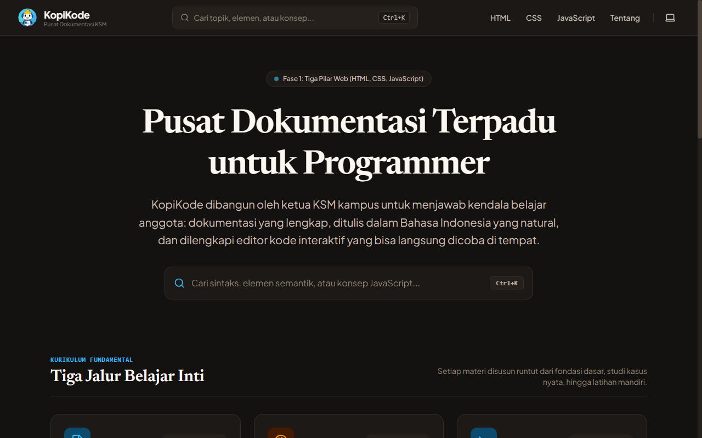
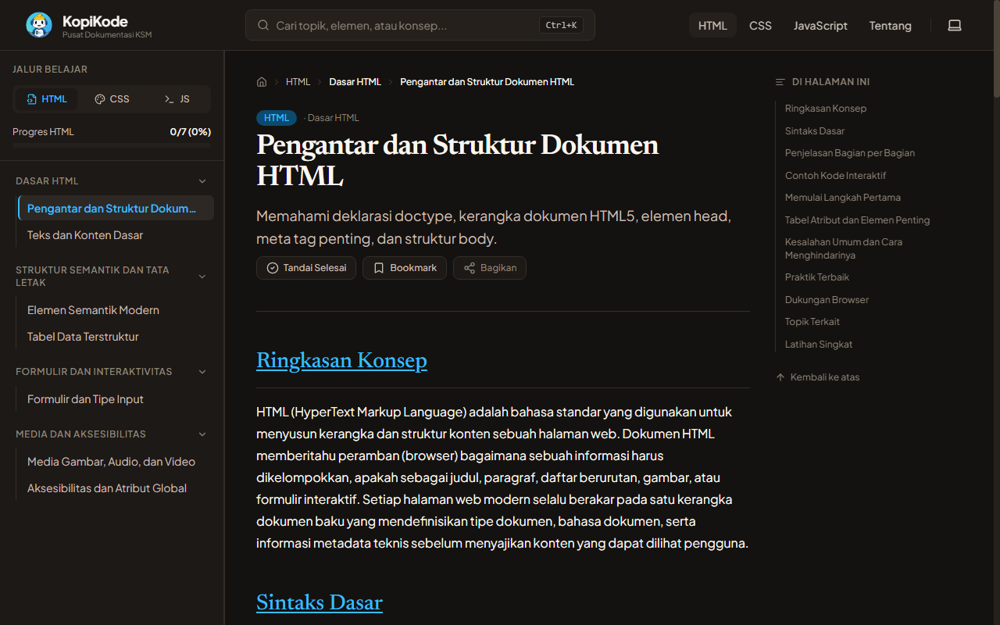
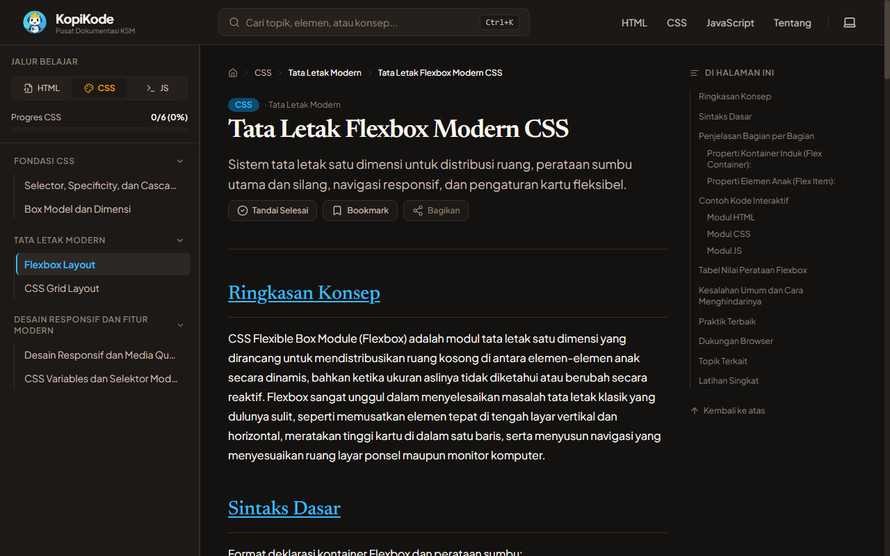
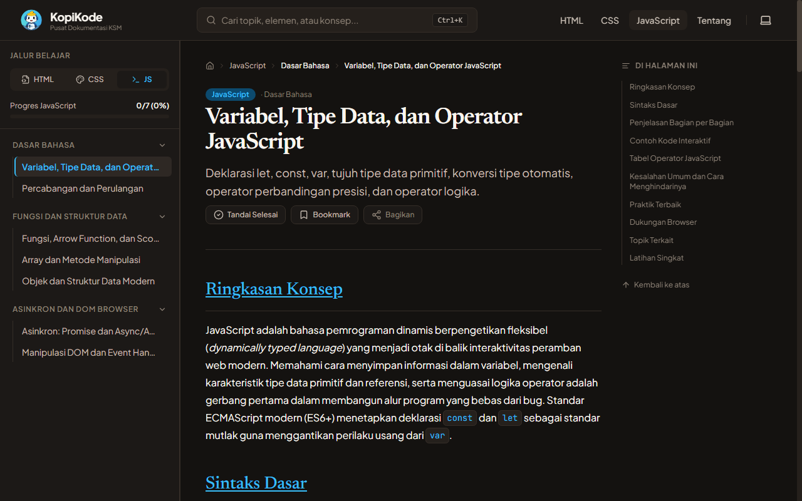
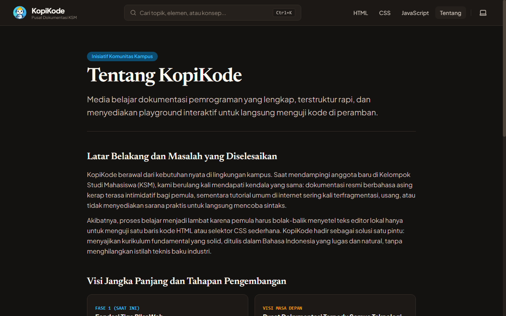

# KopiKode - Pusat Dokumentasi Terpadu untuk Programmer

KopiKode adalah platform dokumentasi terpadu untuk programmer yang dikembangkan oleh ketua Kelompok Studi Mahasiswa (KSM) kampus sebagai sarana belajar terstruktur bagi anggota dan komunitas pengembang di Indonesia. Platform ini menyajikan materi fundamental web modern dalam Bahasa Indonesia yang lugas, terstruktur rapi, bebas dari istilah klise, serta dilengkapi editor interaktif yang memungkinkan pembaca langsung menguji kode di peramban.

---

## Tangkapan Layar Platform

Berikut adalah dokumentasi visual antarmuka platform KopiKode:

### 1. Halaman Beranda

Tampilan beranda dengan pencarian global yang menonjol, tiga jalur belajar inti, dan peta jalan teknologi transparan.



---

### 2. Layout Dokumentasi HTML

Struktur navigasi tiga kolom: sidebar bertingkat di sisi kiri, materi terstruktur di tengah, dan daftar isi dinamis ("Di Halaman Ini") di sisi kanan.



---

### 3. Editor Interaktif CSS Flexbox

Komponen playground interaktif berbasis CodeMirror 6 dengan pratinjau langsung di dalam sandbox yang aman.



---

### 4. Eksekusi JavaScript dan Panel Console Terpadu

Menampilkan keluaran log console secara real-time langsung di bawah editor tanpa perlu membuka developer tools peramban.



---

### 5. Halaman Tentang KopiKode dan Panduan Kontribusi

Menjelaskan sejarah inisiatif kampus, visi jangka panjang, serta tata cara berkontribusi materi.



---

## Tech Stack Utama

- **Framework Web**: Nuxt 3 dengan TypeScript
- **Pengelolaan Konten**: @nuxt/content (Markdown + Komponen Vue MDC)
- **Desain & Styling**: Tailwind CSS v4 dengan Design Tokens via CSS Variables
- **Editor Playground**: CodeMirror 6 dengan ekstensi bahasa HTML, CSS, JavaScript, dan OneDark
- **Syntax Highlighting**: Shiki
- **Pencarian Sisi Klien**: MiniSearch
- **Manajemen State**: Pinia (Preferensi tema, bookmark, progres belajar tersimpan di localStorage)
- **Set Ikon**: Lucide SVG Icons (konsisten dan bebas emoji)

---

## Palet Warna (Design Tokens)

Palet warna KopiKode diselaraskan dengan logo resmi dan mengusung nuansa kopi hangat serta espresso gelap yang memenuhi standar aksesibilitas WCAG AA:

- **Latar Utama (Light)**: `#FAF8F5` (Krem Susu Oat)
- **Latar Utama (Dark)**: `#141210` (Dark Roast Espresso)
- **Aksen Primer**: `#0284C7` (Biru KopiKode dari logo) / `#38BDF8` pada mode gelap
- **Aksen Hangat**: `#D97706` (Karamel Kopi dari logo) / `#F59E0B` pada mode gelap
- **Teks Utama**: `#221C18` (Espresso Pekat) / `#FAF6F0` pada mode gelap

---

## Kurikulum Lengkap Fase 1 (29 Materi Lengkap)

Platform ini telah menyediakan kurikulum lengkap siap pakai dengan standar industri:

### 1. HTML5 (9 Materi)

1. **Pengantar dan Struktur Dokumen**: Doctype, elemen html, head, meta, dan body.
2. **Teks dan Konten Dasar**: Heading, paragraf, list, link, kutipan, dan entitas karakter.
3. **Elemen Semantik Modern**: Header, nav, main, section, article, aside, time, dan footer.
4. **Tabel Data Terstruktur**: Table, thead, tbody, th, tr, td, dan caption semantik.
5. **Formulir dan Tipe Input**: Input text, email, number, date, select, textarea, dan validasi constraint bawaan.
6. **Komponen Dialog dan Interaktivitas Modern**: Dialog modal asli, Popover API, template, dan slot.
7. **Media Gambar, Audio, dan Video**: Img responsif (srcset/sizes), picture art direction, video, audio, dan track subtitle.
8. **Aksesibilitas dan Atribut Global**: Peran ARIA, landmark, urutan fokus tabindex, dan data-* attributes.
9. **Meta Tag, SEO Modern, dan Keamanan Dokumen**: Open Graph, Twitter Cards, canonical URL, dan CSP security headers.

### 2. CSS3 & CSS Modern (9 Materi)

1. **Selector, Specificity, dan Cascade**: Bobot spesifisitas, inheritance, dan hierarki cascade.
2. **Box Model dan Dimensi**: Margin, border, padding, content-box vs border-box, dan margin collapsing.
3. **Flexbox Layout**: Main axis, cross axis, justify-content, align-items, flex-grow, shrink, dan basis.
4. **CSS Grid Layout**: Grid-template-columns, fr unit, repeat, minmax, auto-fit/fill, dan grid-area.
5. **Posisi Elemen dan Stacking Context**: Static, relative, absolute, fixed, sticky, z-index, dan stacking context isolation.
6. **Desain Responsif dan Media Query**: Breakpoint mobile-first, clamp(), min(), max(), dan viewport units.
7. **CSS Variables dan Selektor Modern**: Custom properties (:root), :has(), :is(), :where(), dan CSS nesting native.
8. **Transisi, Transformasi, dan Animasi CSS**: Transition timing, transform 2D/3D, keyframes, hardware acceleration GPU, dan prefers-reduced-motion.
9. **Pseudo-class dan Pseudo-element Lengkap**: State (:hover, :focus-visible, :active), tree-structural (:nth-child), dan visual decoration (::before, ::after, ::marker).

### 3. JavaScript Modern ES2024+ (11 Materi)

1. **Variabel, Tipe Data, dan Operator**: Let, const, tipe primitif, konversi eksplisit/implisit, dan operator logika modern.
2. **Percabangan dan Perulangan**: If-else, switch case, ternari, for, while, for...of, dan for...in.
3. **Fungsi, Lingkup Variabel, dan Closure**: Deklarasi vs ekspresi, arrow function, lexical scope, closure, dan IIFE.
4. **Array dan Metode Manipulasi**: Map, filter, reduce, find, some, every, flatMap, dan mutasi vs immutability.
5. **Objek dan Struktur Data Kompleks**: Object literal, destructuring, spread/rest, Map, Set, WeakMap, dan properti dinamis.
6. **Pemrograman Berorientasi Objek, Class, dan Prototype**: Prototype chain, class ES6, constructor, inheritance extends/super, private fields (#), dan static methods.
7. **Modul ES, Iterator, dan Generator**: Import, export named/default, dynamic import(), Symbol.iterator, dan generator function (yield).
8. **Asinkron: Promise dan Async/Await**: Event loop, call stack, microtask queue, Promise lifecycle, async/await, dan Fetch API.
9. **Manipulasi DOM dan Event Handling**: QuerySelector, createElement, appendChild, classList, event listener, bubbling, capturing, dan delegation.
10. **Penanganan Error, Regular Expression, dan Date**: Try-catch-finally, custom Error class, regex pattern syntax, Intl date formatter, dan validasi string.
11. **Web Storage dan Modern Browser APIs**: LocalStorage, sessionStorage, JSON serializer, History API, Timer, dan IntersectionObserver.

---

## Prasyarat dan Cara Menjalankan

### 1. Prasyarat Lingkungan

- Node.js versi 18 ke atas (direkomendasikan Node.js LTS v20 atau v22)
- npm versi 9 ke atas

### 2. Instalasi Dependensi

```bash
npm install
```

### 3. Menjalankan Server Pengembangan (Dev Mode)

```bash
npm run dev
```

Aplikasi akan aktif di alamat: `http://localhost:3000`

### 4. Memeriksa Format Kode (Linting)

```bash
npm run lint
```

### 5. Membangun Versi Produksi (Production Build)

```bash
npm run build
```

### 6. Menjalankan Hasil Build Produksi

```bash
node .output/server/index.mjs
```

---

## Struktur Folder Proyek

```text
KopiKode/
├── assets/
│   └── css/
│       └── main.css             # Konfigurasi Tailwind v4 dan variabel design token
├── components/
│   ├── app/
│   │   ├── AppHeader.vue        # Header navigasi, pencarian, dan pengalih tema
│   │   ├── AppFooter.vue        # Footer informasi KSM dan lisensi terbuka
│   │   └── AppBreadcrumb.vue    # Jejak navigasi dinamis
│   ├── content/
│   │   ├── CodePlayground.vue   # Komponen editor CodeMirror 6 + sandbox iframe
│   │   ├── KotakPeringatan.vue  # Callout tips, peringatan, dan info semantik
│   │   └── TabelParameter.vue   # Pembungkus tabel parameter responsif
│   ├── dok/
│   │   ├── SidebarNavigasi.vue  # Sidebar bertingkat dan drawer mobile
│   │   ├── DaftarIsiHalaman.vue # TOC "Di Halaman Ini" dengan active spy
│   │   ├── TombolNavigasi.vue   # Tombol Sebelumnya dan Selanjutnya
│   │   └── PenandaProgres.vue   # Tombol Bookmark dan Sudah Dipelajari
│   └── pencarian/
│       └── ModalPencarian.vue   # Modal pencarian global Ctrl/Cmd + K
├── composables/
│   ├── useTema.ts               # Pengatur tema tanpa flicker
│   └── usePencarian.ts          # Integrasi MiniSearch
├── content/
│   ├── html/                    # Materi Markdown HTML5
│   ├── css/                     # Materi Markdown CSS3
│   └── javascript/              # Materi Markdown JavaScript
├── data/
│   └── teknologiRegistry.ts     # Titik sentral registrasi teknologi modular
├── layouts/
│   ├── default.vue              # Layout standar beranda dan halaman umum
│   └── dokumentasi.vue          # Layout tiga kolom dokumentasi
├── pages/
│   ├── index.vue                # Halaman beranda
│   ├── tentang.vue              # Halaman profil KSM dan panduan kontribusi
│   ├── [...slug].vue            # Renderer dinamis Nuxt Content
├── public/
│   ├── Logo.png                 # Logo utama KopiKode
│   ├── favicon.ico              # Favicon resmi
│   └── dokumentasi/             # Tangkapan layar antarmuka
├── stores/
│   ├── preferensiStore.ts       # Store Pinia preferensi tema dan tampilan
│   └── belajarStore.ts          # Store Pinia progres belajar dan bookmark
├── nuxt.config.ts               # Konfigurasi Nuxt 3
├── package.json                 # Daftar paket pustaka
└── tsconfig.json                # Konfigurasi TypeScript
```

---

## Pola Standar 10 Bagian Setiap Materi

Demi menjaga kualitas dan konsistensi, setiap dokumen materi baru wajib mengikuti struktur 10 bagian berikut:

1. **Ringkasan Konsep**: Satu paragraf lugas menerangkan apa konsep tersebut dan kapan harus digunakan.
2. **Sintaks Dasar**: Contoh blok kode paling mendasar.
3. **Penjelasan Bagian per Bagian**: Rincian setiap token, argumen, atau elemen.
4. **Contoh Kode Interaktif**: Implementasi menggunakan komponen `<code-playground>`.
5. **Tabel Parameter / Atribut**: Referensi tabel nilai valid menggunakan `<tabel-parameter>`.
6. **Kesalahan Umum dan Cara Menghindarinya**: Callout peringatan kesalahan umum pemula.
7. **Praktik Terbaik**: Panduan aksesibilitas (a11y), performa, dan arsitektur kode.
8. **Dukungan Browser**: Ringkasan kompatibilitas peramban modern.
9. **Topik Terkait**: Tautan internal ke materi pendukung lain.
10. **Latihan Singkat**: Tantangan kecil dengan playground untuk dikerjakan mandiri.

Di bagian paling akhir berkas, sertakan tautan rujukan resmi ke MDN Web Docs atau spesifikasi W3C.

---

## Panduan Penggunaan Komponen `<code-playground>`

Komponen playground dapat langsung dipanggil di dalam berkas Markdown materi:

```html
<code-playground
  id-contoh="demo-nama-unik"
  judul="Judul Contoh Kasus"
  :tab-tersedia="['html', 'css', 'js']"
  kode-html="<button id='btn'>Klik Saya</button>"
  kode-css="button { background: #0284c7; color: white; padding: 8px 16px; border: none; border-radius: 6px; cursor: pointer; }"
  kode-js="document.getElementById('btn').addEventListener('click', () => { console.log('Tombol berhasil diklik!'); });"
>
</code-playground>
```

### Properti yang Tersedia:

- `id-contoh`: Identifier unik untuk memisahkan log console antar-editor.
- `judul`: Judul kartu playground (opsional).
- `tab-tersedia`: Array tab bahasa yang diizinkan tampil: `['html', 'css', 'js']`.
- `kode-html`, `kodeCss`, `kodeJs`: Kode sumber default.
- `tinggiEditor`: Ketinggian area kode (default: `'280px'`).
- `modeTampilan`: Pilihan tata letak `'berdampingan'` atau `'atas_bawah'`.

---

## Panduan Menambah Teknologi Baru

KopiKode dirancang modular berbasis registry. Untuk menambah teknologi baru (misalnya Python atau TypeScript), Anda **tidak perlu merombak layout komponen**:

1. Buka berkas `data/teknologiRegistry.ts`.
2. Tambahkan entri baru pada array `daftarTeknologi`:
   ```typescript
   {
     id: 'python',
     nama: 'Python',
     slug: 'python',
     kategori: 'bahasa_pemrograman',
     deskripsiSingkat: 'Bahasa pemrograman tingkat tinggi yang mudah dibaca.',
     deskripsiLengkap: 'Kurikulum Python mencakup sintaks dasar, fungsi, dan struktur data.',
     ikonNama: 'Binary',
     status: 'tersedia',
     versi: 'Python 3.12+',
     warnaAksen: '#D97706',
     babMateri: [
       {
         namaKategori: 'Dasar Python',
         daftarMateri: [
           {
             judul: 'Sintaks dan Variabel',
             slug: 'sintaks-dan-variabel',
             deskripsi: 'Memahami deklarasi variabel dan tipe data dinamis.',
             ringkasan: 'Langkah pertama mengenal sintaks Python.',
             estimasiMenit: 10
           }
         ]
       }
     ]
   }
   ```
3. Buat folder baru di bawah `content/<slug-teknologi>/` (contoh: `content/python/sintaks-dan-variabel.md`).
4. Halaman dokumentasi, sidebar, pencarian global (Ctrl+K), jejak navigasi, dan perhitungan progres belajar otomatis mendeteksi teknologi baru tersebut.

---

## Standar Aksesibilitas dan Kebijakan Konten

- Seluruh kode antarmuka dan konten dilarang menggunakan karakter em dash atau en dash. Gunakan tanda hubung biasa (`-`), koma, atau titik.
- Seluruh antarmuka dilarang menggunakan emoji. Gunakan set ikon SVG Lucide yang konsisten.
- Variabel dan komentar dalam kode ditulis dalam Bahasa Indonesia yang ringkas dan jelas.
- Memenuhi standar WCAG AA dengan kontras warna teruji, navigasi keyboard penuh, dan dukungan pembaca layar.

---

## Lisensi dan Penghargaan

Proyek ini dibangun di bawah lisensi terbuka untuk tujuan edukasi kampus dan komunitas developer Indonesia. Dikelola oleh ketua KSM kampus dan didukung oleh seluruh kontributor mahasiswa.
